# FPGA Placement with Simulated Annealing: Approach Report

## 1. Overview
This project implements a simulated annealing (SA) based placer for FPGA logic blocks and IOs. The placer aims to minimize total wirelength and congestion, efficiently handling large netlists and grid sizes by leveraging incremental update techniques and careful cost function design.

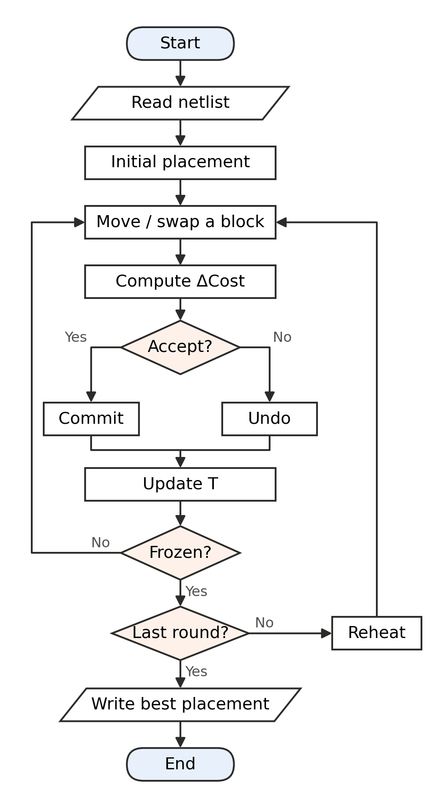

This is the high-level flow; Section 7 shows the final flow with the enhancements added after the original submission.

### Test Cases
The three hidden test cases were added after all parameters had been chosen on the five public ones (Section 7.7).

| Case | Grid (R × C) | Blocks | IOs | Nets | Block utilization |
|------|--------------|--------|-----|------|-------------------|
| alu4 | 26 × 26 | 475 | 16 | 222 | 70% |
| apex4 | 25 × 25 | 411 | 16 | 335 | 66% |
| clma_2 | 71 × 71 | 3580 | 61 | 1559 | 71% |
| elliptic | 36 × 36 | 968 | 128 | 467 | 75% |
| pdc | 48 × 48 | 1513 | 34 | 784 | 66% |
| hidden1 | 65 × 65 | 3288 | 6 | 2187 | 78% |
| hidden2 | 110 × 110 | 8910 | 136 | 2371 | 74% |
| hidden3 | 119 × 119 | 13000 | 37 | 3577 | 92% |

### Performance Summary
Results of the current version with seed 1 (`./run_tests.sh`). The change of each final value from its initial value is given in parentheses, and the runtime is the CPU time of the whole run (one run alone). In this and every table below, the mean is taken over the eight test cases, and a mean percentage is the mean of the per-case percentages:

| Case | Initial HPWL | Final HPWL | Initial CC | Final CC | Initial cost | Final cost | Runtime |
|------|--------------|------------|------------|----------|--------------|------------|---------|
| alu4 | 5952 | 2480 (-58.3%) | 1.6075 | 1.0530 (-34.5%) | 2.0000 | 1.0717 (-46.4%) | 15 s |
| apex4 | 7803 | 3725 (-52.3%) | 1.6933 | 1.0408 (-38.5%) | 2.0000 | 1.0920 (-45.4%) | 21 s |
| clma_2 | 95364 | 24687 (-74.1%) | 1.6505 | 1.0150 (-38.5%) | 2.0000 | 0.8738 (-56.3%) | 47 s |
| elliptic | 15920 | 5137 (-67.7%) | 1.4078 | 1.0215 (-27.4%) | 2.0000 | 1.0483 (-47.6%) | 24 s |
| pdc | 37012 | 14607 (-60.5%) | 1.6603 | 1.0382 (-37.5%) | 2.0000 | 1.0199 (-49.0%) | 38 s |
| hidden1 | 104490 | 14824 (-85.8%) | 1.7427 | 1.0096 (-42.1%) | 2.0000 | 0.7212 (-63.9%) | 45 s |
| hidden2 | 208661 | 20410 (-90.2%) | 1.6623 | 1.0029 (-39.7%) | 2.0000 | 0.7011 (-64.9%) | 56 s |
| hidden3 | 212795 | 47600 (-77.6%) | 1.5555 | 1.0053 (-35.4%) | 2.0000 | 0.8699 (-56.5%) | 95 s |
| **Mean** | 86000 | 16684 (-70.8%) | 1.6225 | 1.0233 (-36.7%) | 2.0000 | 0.9247 (-53.8%) | 43 s |

### Comparison with the original version
Mean HPWL, CC and cost ($\text{HPWL} / \text{HPWL}_\text{init} + \text{CC} / \text{CC}_\text{init}$, Section 2; lower is better) over seeds 1 to 5, and mean wall-clock runtime with 25 runs in parallel (15 for the hidden test cases). The original version (branch `w/o-Round2+-Enhancement`) is called **w/o Round2+ Enhancement** in this report; it was rebuilt with this cost so that only the algorithm differs (Section 7.1).

| Case | w/o Round2+ Enhancement HPWL | Current HPWL | Change | w/o Round2+ Enhancement CC | Current CC | Change | w/o Round2+ Enhancement cost | Current cost | Change | w/o Round2+ Enhancement runtime | Current runtime | Change |
|------|------------------|--------------|--------|----------------|------------|--------|------------------|--------------|--------|---------------------|-----------------|--------|
| alu4 | 3274 | **2496** | -23.8% | 1.0364 | **1.0527** | +1.6% | 1.1948 | **1.0742** | -10.1% | 43 s | **21 s** | -52% |
| apex4 | 4163 | **3723** | -10.6% | 1.0389 | **1.0402** | +0.1% | 1.1470 | **1.0914** | -4.9% | 44 s | **24 s** | -45% |
| clma_2 | 41436 | **24132** | -41.8% | 1.0168 | **1.0135** | -0.3% | 1.0506 | **0.8671** | -17.5% | 122 s | **52 s** | -57% |
| elliptic | 7555 | **5068** | -32.9% | 1.0164 | **1.0237** | +0.7% | 1.1966 | **1.0455** | -12.6% | 60 s | **28 s** | -54% |
| pdc | 18702 | **14611** | -21.9% | 1.0310 | **1.0382** | +0.7% | 1.1263 | **1.0201** | -9.4% | 92 s | **44 s** | -52% |
| hidden1 | 32660 | **14969** | -54.2% | 1.0104 | **1.0090** | -0.1% | 0.8924 | **0.7223** | -19.1% | 107 s | **44 s** | -59% |
| hidden2 | 69248 | **20570** | -70.3% | 1.0085 | **1.0029** | -0.5% | 0.9385 | **0.7019** | -25.2% | 130 s | **54 s** | -58% |
| hidden3 | 124703 | **47555** | -61.9% | 1.0156 | **1.0047** | -1.1% | 1.2389 | **0.8694** | -29.8% | 172 s | **88 s** | -49% |
| **Mean** | 37718 | **16640** | -39.7% | 1.0218 | **1.0231** | +0.1% | 1.0981 | **0.9240** | -16.1% | 96 s | **44 s** | -53% |

The gain comes from HPWL; CC is already close to its lower bound of 1 in w/o Round2+ Enhancement and changes by at most 1.6% (slightly up on four public cases, down on the larger ones; Section 7.1).

The changes are, in order: picking the best placement by total cost with a fixed cost scale (Sections 7.2, 7.3), range-limited moves (7.4), colder restarts and early stop (7.5), and guided moves (7.6). Section 7.1 shows the effect of each step on all test cases, and Section 7.7 discusses the hidden ones, which were only added after all parameters had been chosen.

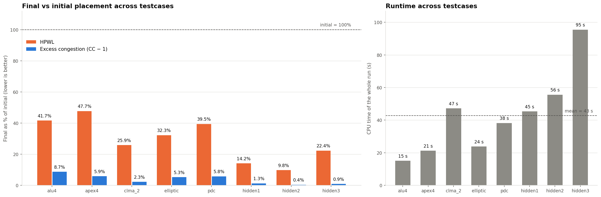

## 2. Simulated Annealing Cost Function Design and Parameters
The SA minimizes the total wirelength and the congestion cost, both normalized by their values in the initial placement:

$$
	\text{Cost} = \frac{\text{HPWL}}{\text{HPWL}_\text{init}} + \frac{\text{CC}}{\text{CC}_\text{init}}
$$

Where:
- $\text{HPWL}$ is the sum of half-perimeter wirelengths of all nets.
- $\text{CC} = N \cdot \sum U^2 / (\sum U)^2 = 1 + (\sigma_U / \mu_U)^2$ is the congestion cost of the cell coverage map $U$ over its $N$ cells, computed from the linear and quadratic sums of $U$. $\text{CC} = 1$ means perfectly uniform coverage.

The initial cost is 2. This cost is also the measure used to compare results in this report. A move is evaluated by its change in cost,

$$
	\Delta\text{Cost} = S \cdot \left( \frac{\Delta \text{HPWL}}{\text{HPWL}_\text{init}} + \frac{\Delta \text{CC}}{\text{CC}_\text{init}} \right)
$$

and is accepted if $\Delta\text{Cost} < 0$, or otherwise with probability $e^{-\Delta\text{Cost} / T}$. $S = 100 \times 800{,}000$ is a fixed scale (100 times the first round's initial temperature, Section 7.3).

**Best solution:** whenever an accepted move gives a lower $\text{Cost}$ than the best placement seen so far, that placement is saved. The saved best placement is written as the output.

**Parameter values used:**
- SA rounds: 5
- Initial temperature: $T_0 = 800{,}000$ for round 1; round 2 starts at $T_\text{reheat}$ (Section 3), and each later round at $0.66\times$ the previous round's initial temperature
- Move range: adaptive $R_\text{limit}$ with a target acceptance rate of $0.44$; round 1 starts with the whole chip, rounds 2+ with half of it
- Guided moves: $30\%$ of the moves in rounds 2+, best of 4 random blocks, least congested of 4 random target sites; nets with more than 30 terminals are ignored
- Cooling interval: every 5,000 iterations
- Cooling rates: $0.9$ (acceptance rate $>0.95$), $0.99$ ($>0.8$), $0.99$ ($>0.15$), $0.9$ (otherwise)
- Termination: a round ends when $T < 10^{-3}$, or early once $R_\text{limit} = 1$ and $\text{Cost}$ has not improved by more than $0.01\%$ for 20 temperature steps; a safety time limit of 235 seconds applies to the whole run


## 3. Temperature Schedule and Moves
**Rounds.** SA runs for 5 rounds, each continuing from the placement left by the previous round. During round 1, the temperature at which the move range $R_\text{limit}$ first shrinks to half of the chip is recorded as $T_\text{reheat}$; rounds 2+ restart from there (Section 7.5):

| Round | Initial $T$ | Initial $R_\text{limit}$ |
|-------|-------------|---------------------------|
| 1 | $T_0 = 800{,}000$ | whole chip, $\max(C, R)$ |
| $k \ge 2$ | $T_\text{reheat} \times 0.66^{k-2}$ | $0.5 \times \max(C, R)$ |

**Moves.** Each iteration moves one block, or swaps two blocks if the target site is occupied:
- **Range-limited move:** a random block goes to a random site within $\pm R_\text{limit}$ of it. $R_\text{limit}$ adapts to keep the acceptance rate near 44% (Section 7.4).
- **Guided move** (30% of the moves in rounds 2+): a block goes into its optimal region, where its nets are shortest, preferring the least congested site there (Section 7.6).

**Cooling schedule.** Every 5,000 iterations, the acceptance rate (accepted moves / attempted moves) is measured and the temperature is lowered:

```
if (acceptRate > 0.95)
	coolingRate = 0.9;
else if (acceptRate > 0.8)
	coolingRate = 0.99;
else if (acceptRate > 0.15)
	coolingRate = 0.99;
else
	coolingRate = 0.9;
T = T * coolingRate;
```

The temperature drops quickly ($\times 0.9$) at both ends: when almost every move is accepted (the placement is still random), and when almost every move is rejected (the placement is frozen). In between, where most of the useful optimization happens, it cools slowly ($\times 0.99$).

**Termination.** A round ends when $T < 10^{-3}$, or earlier once $R_\text{limit} = 1$ and the cost has not improved by more than 0.01% for 20 temperature steps (Section 7.5). A time limit of 235 seconds for the whole run is kept as a safety net; the test cases finish well before it (15 to 47 seconds for all 5 rounds on the public test cases, 45 to 95 seconds on the hidden ones).

## 4. Fast Incremental Updates for Nets, U, and Congestion Costs
Every move only changes a few nets, so the costs are updated incrementally instead of being recomputed:

### 4.1. Net Bounding Box Updates
- Each net maintains its bounding box ($x_{min}$, $x_{max}$, $y_{min}$, $y_{max}$).
- When a block is moved or swapped, only the nets connected to the moved blocks are considered, and nets that contain both swapped blocks are skipped (Section 5.1).
- A net's box grows directly when a block moves outside it. When a block leaves an edge of the box, the anchor check (Section 5.2) decides whether that edge must be recomputed; if so, only that axis is rescanned over all connected blocks and IOs.
- All changes are recorded in a `NetDiff` structure, allowing efficient rollback if a move is rejected.

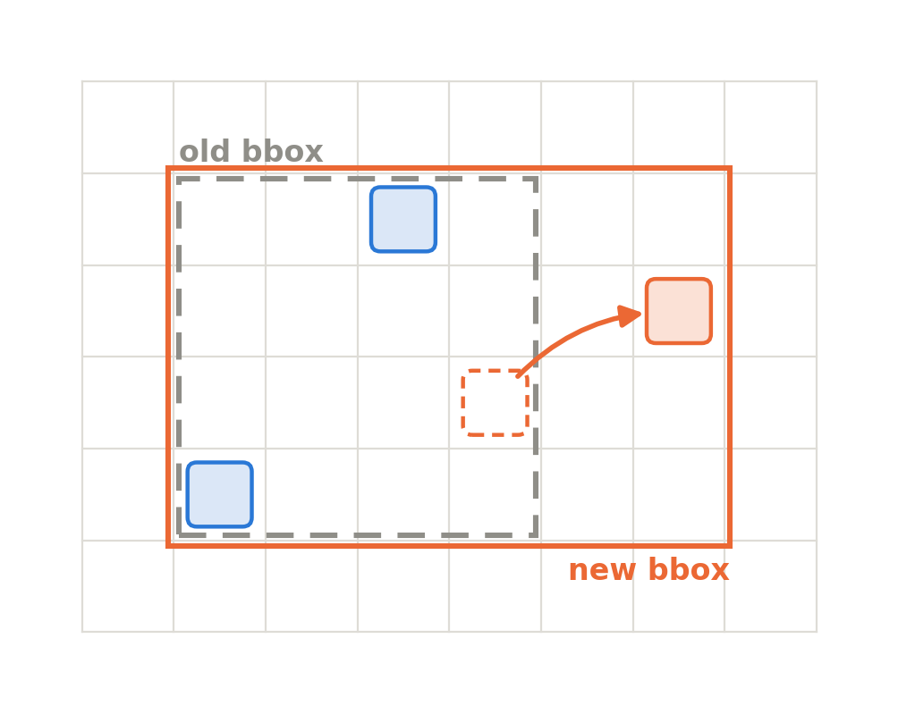

**Pseudocode:**
```
for each affected net:
    save old bounding box (x_min, x_max, y_min, y_max)
    if moved block extends the box:
        x_min = min(x_min, new_x)
        x_max = max(x_max, new_x + 1)
        ... (same for y)
    if moved block was on a box edge and no anchor remains there:
        rescan all connected blocks and IOs along that axis
    record new bounding box in NetDiff
```


### 4.2. U Grid and Congestion Cost Updates
- For each changed net, $U$ is decremented over its old bounding box and incremented over its new one.
- The sums $CC_{linear} = \sum U$ and $CC_{square} = \sum U^2$ are updated in place as $U$ changes, so CC never needs a full recomputation.
- Rollback applies the inverse of the recorded diffs.

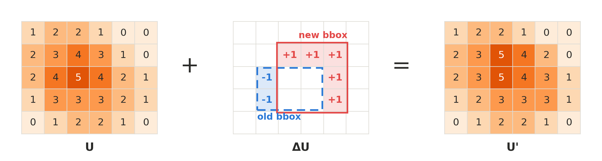

**Pseudocode:**
```
for each NetDiff in net_diffs:
    // remove old coverage
    for x in ceil(old_x_min) to floor(old_x_max)-1:
        for y in ceil(old_y_min) to floor(old_y_max)-1:
            CC_linear -= U[x][y]
            CC_square -= U[x][y] * U[x][y]
            U[x][y] -= 1
    // add new coverage
    for x in ceil(new_x_min) to floor(new_x_max)-1:
        for y in ceil(new_y_min) to floor(new_y_max)-1:
            U[x][y] += 1
            CC_linear += U[x][y]
            CC_square += U[x][y] * U[x][y]
```


### 4.3. Efficient Data Structures
- Static buffers (`static vector<pair<int, bool>> affected_nets` and `static vector<NetDiff> net_diffs`, see `SA_update.cpp`) are used for affected nets and net diffs to avoid repeated allocations.
- All updates and rollbacks are performed in-place, minimizing overhead and maximizing cache efficiency.

## 5. Optimization Improvements

### 5.1 Affected Net Filtering
During block swaps, nets that connect both moving blocks are excluded from the cost evaluation since their bounding box is invariant to the swap. This is detected using a hash set intersection in $O(n_1 + n_2)$ time, avoiding redundant calculations.

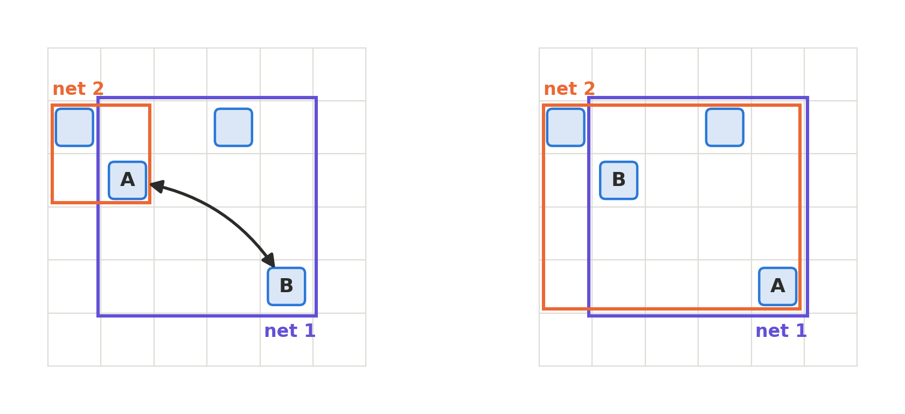

### 5.2 Anchor-Based Boundary Checks
The bounding box update uses anchor checks to determine when a boundary can change:
- If a block moves away from a boundary, we search for another block/IO ("anchor") that still occupies that boundary position.
- If an anchor exists, the boundary is preserved without full recalculation.
- If no anchor exists, only that specific axis needs full recalculation, reducing redundant work.

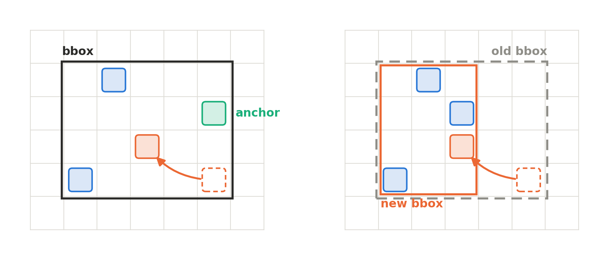

## 6. Visualization
- With `SA_TRACE` enabled in `src/main.cpp` (on by default), the placer writes `<output>_trace.csv` next to the output file, with one row per temperature step: round, iteration, time, $T$, acceptance rate, the current and best HPWL and CC, the round's initial $T$, and $R_\text{limit}$.
- The placer takes an optional random seed, `./placer <input> <output> [seed]` (default 1), and `python3 bench.py --out <dir>` runs all test cases with several seeds and reports the mean and standard deviation of HPWL, CC, $\text{HPWL} \cdot \text{CC}$, $\text{Cost}$ and runtime (`--compare <results.json>` compares two versions).
- `./plot_all.sh` turns the results in `result/` into these plots in `plot/`:

| Plot | Script | Content |
|------|--------|---------|
| `<case>_density.png` | `plot_placement.py --mode density` | Initial and final placement side by side, colored by $U$ on a shared scale |
| `<case>_cc.png` | `plot_placement.py --mode cc` | Initial and final $U / \text{mean}(U)$ on a shared scale centered at 1 |
| `<case>_hpwl.png` | `plot_metrics.py` | Per-net HPWL, initial vs final |
| `<case>_sa.png` | `plot_sa.py` | HPWL and $\text{CC} - 1$ (log scales), the cost (on a shifted log axis, $\log(\text{cost} - c_0)$ with $c_0$ just below the final result, so the small gains of the later rounds are visible without clipping the curve), temperature, acceptance rate and $R_\text{limit}$ over the SA iterations |
| `summary.png` | `plot_metrics.py --all` | HPWL and excess congestion $\text{CC} - 1$ of all cases, final as a percentage of initial, and the runtime of each case |

- `./plot_all.sh` also copies the result plots embedded in this report into `docs/figures/results/`, since `plot/` is not tracked. The two plots of the earlier version (`*_before_sa.png`) come from its benchmark traces: `python3 plot_sa.py bench/abl_v2/clma_2_s1_trace.csv --name clma_2_before --save docs/figures/results/`.
- The diagrams in this report are generated by `python3 docs/make_diagrams.py` into `docs/figures/` (PNG and SVG).
- **Animation of the SA run.** With the environment variable `SA_SNAPSHOT_EVERY=<n>`, the placer also writes the positions of all blocks every $n$ temperature steps to `<output>_snap.bin`, plus one every 500 iterations during the first 50,000 iterations of round 1, where the whole placement is scrambled; this does not change the result. `animate_sa.py` turns it into a GIF with the blocks colored by their starting column, the map of $U / \text{mean}(U)$, and the cost over the run. With `--frames`, the frames are spaced by how much the picture visibly changes, so the scramble, the clusters forming as round 1 cools, and the restarts play in slow motion:

```
SA_SNAPSHOT_EVERY=1 ./placer testcases/hidden3.txt result/hidden3.out 1
python3 animate_sa.py testcases/hidden3.txt result/hidden3_snap.bin --frames 480 --fps 15 --dpi 60 \
    --hold-start 15 --save plot/hidden3_anim.gif
```


## 7. Improvements over the Original Version
This section explains the changes made after the original submission (branch `w/o-Round2+-Enhancement`, called **w/o Round2+ Enhancement** in the tables), in the order they were added. The final flow is:

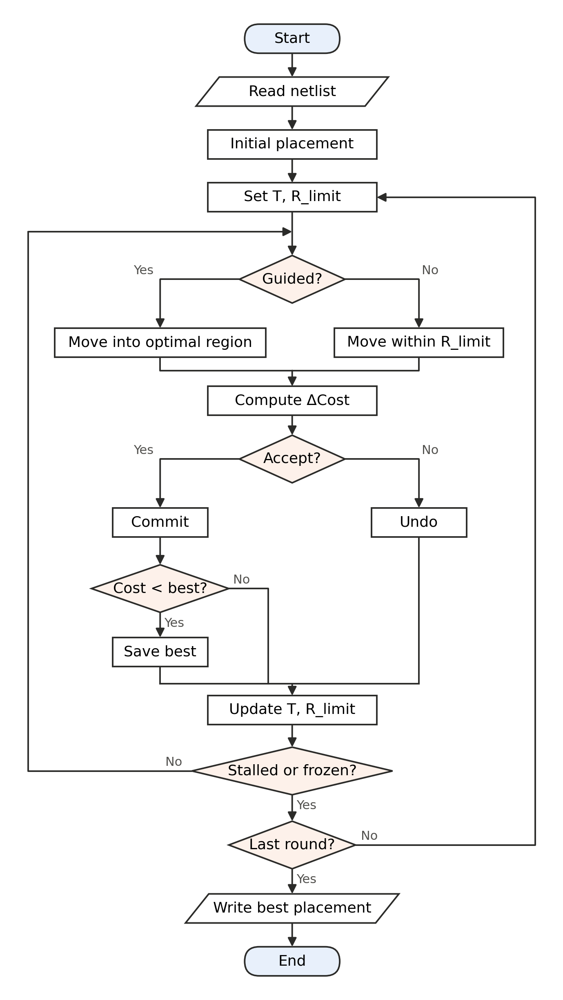

Compared with the original flow in Section 1:
- **Set T, R_limit** runs at the start of every round: round 1 starts hot with the whole chip as the move range, and later rounds restart colder with a smaller move range (Section 7.5).
- **Guided?** chooses between a guided move into the block's optimal region (Section 7.6) and a random move within the move range $R_\text{limit}$ (Section 7.4).
- **Cost < best? / Save best** keep the placement with the lowest cost (Section 7.2).
- **Stalled or frozen?** also ends a round once the cost stops improving (Section 7.5).

### 7.1 How the changes are measured
- Every version is measured with the cost of Section 2, $\text{Cost} = \text{HPWL} / \text{HPWL}_\text{init} + \text{CC} / \text{CC}_\text{init}$. The earlier versions were rebuilt with this cost (only the $\Delta\text{Cost}$ normalization was changed, and in versions that pick the best placement by cost, that cost too; w/o Round2+ Enhancement keeps its own best-solution rule), so each step below shows the effect of the algorithm change alone.
- The SA is random, so one run per version is not enough to tell a real improvement from luck. Each version runs every test case with seeds 1 to 5 (`bench.py`, Section 6) and the table uses the mean. For the current version, the seed-to-seed standard deviation of the cost is about 0.1% to 0.5%, so changes smaller than that are within noise.
- The tables cover all eight test cases; the Mean column is the mean over them (for a percentage, the mean of the per-case percentages). The three hidden test cases were added last and are discussed separately in Section 7.7.

#### Change of each step
Change of the mean cost from the step before (negative is better):

| Step | Section | alu4 | apex4 | clma_2 | elliptic | pdc | hidden1 | hidden2 | hidden3 | Mean |
|------|---------|---|---|---|---|---|---|---|---|---|
| w/o Round2+ Enhancement (cost) | | 1.1948 | 1.1470 | 1.0506 | 1.1966 | 1.1263 | 0.8924 | 0.9385 | 1.2389 | 1.0981 |
| Best by total cost, fixed cost scale | 7.2, 7.3 | -7.5% | -2.2% | +0.1% | -8.1% | -1.3% | -0.2% | -0.3% | -0.5% | -2.5% |
| Range-limited moves | 7.4 | -2.6% | -2.6% | -14.1% | -4.7% | -7.9% | -16.3% | -19.5% | -22.1% | -11.2% |
| Colder restarts, early stop | 7.5 | 0.0% | -0.1% | -3.1% | -0.1% | -0.1% | -1.9% | -4.4% | -6.5% | -2.0% |
| Guided moves | 7.6 | -0.1% | 0.0% | -0.9% | -0.3% | -0.2% | -1.3% | -2.5% | -3.1% | -1.1% |
| **Total vs w/o Round2+ Enhancement** | | **-10.1%** | **-4.9%** | **-17.5%** | **-12.6%** | **-9.4%** | **-19.1%** | **-25.2%** | **-29.8%** | **-16.1%** |

#### Change from w/o Round2+ Enhancement
Change of each stage from w/o Round2+ Enhancement, as $\text{value} / \text{value}_\text{w/o} - 1$ (mean over seeds 1 to 5; negative is better). The first row gives the values of w/o Round2+ Enhancement itself:

**Cost**

| Stage | alu4 | apex4 | clma_2 | elliptic | pdc | hidden1 | hidden2 | hidden3 | Mean |
|-------|---|---|---|---|---|---|---|---|---|
| w/o Round2+ Enhancement (cost) | 1.1948 | 1.1470 | 1.0506 | 1.1966 | 1.1263 | 0.8924 | 0.9385 | 1.2389 | 1.0981 |
| + Best by total cost, fixed cost scale | -7.5% | -2.2% | +0.1% | -8.1% | -1.3% | -0.2% | -0.3% | -0.5% | -2.5% |
| + Range-limited moves | -10.0% | -4.7% | -14.0% | -12.3% | -9.1% | -16.4% | -19.7% | -22.5% | -13.6% |
| + Colder restarts, early stop | -10.0% | -4.8% | -16.7% | -12.4% | -9.2% | -18.0% | -23.3% | -27.6% | -15.2% |
| **+ Guided moves (current)** | **-10.1%** | **-4.9%** | **-17.5%** | **-12.6%** | **-9.4%** | **-19.1%** | **-25.2%** | **-29.8%** | **-16.1%** |

**HPWL**

| Stage | alu4 | apex4 | clma_2 | elliptic | pdc | hidden1 | hidden2 | hidden3 | Mean |
|-------|---|---|---|---|---|---|---|---|---|
| w/o Round2+ Enhancement (HPWL) | 3274 | 4163 | 41436 | 7555 | 18702 | 32660 | 69248 | 124703 | 37718 |
| + Best by total cost, fixed cost scale | -17.7% | -5.1% | -0.1% | -21.0% | -3.5% | -0.9% | -0.8% | -1.1% | -6.3% |
| + Range-limited moves | -22.8% | -10.0% | -32.9% | -31.5% | -20.5% | -46.1% | -54.6% | -46.4% | -33.1% |
| + Colder restarts, early stop | -22.7% | -9.9% | -39.4% | -31.8% | -20.6% | -50.7% | -64.6% | -56.9% | -37.1% |
| **+ Guided moves (current)** | **-23.8%** | **-10.6%** | **-41.8%** | **-32.9%** | **-21.9%** | **-54.2%** | **-70.3%** | **-61.9%** | **-39.7%** |

**CC**

| Stage | alu4 | apex4 | clma_2 | elliptic | pdc | hidden1 | hidden2 | hidden3 | Mean |
|-------|---|---|---|---|---|---|---|---|---|
| w/o Round2+ Enhancement (CC) | 1.0364 | 1.0389 | 1.0168 | 1.0164 | 1.0310 | 1.0104 | 1.0085 | 1.0156 | 1.0218 |
| + Best by total cost, fixed cost scale | +1.2% | +0.4% | +0.2% | +0.5% | +0.4% | +0.2% | 0.0% | 0.0% | +0.4% |
| + Range-limited moves | +1.0% | -0.2% | -0.7% | +0.3% | +0.2% | -0.5% | -0.7% | -1.0% | -0.2% |
| + Colder restarts, early stop | +0.9% | -0.3% | -0.7% | +0.3% | 0.0% | -0.4% | -0.7% | -1.2% | -0.3% |
| **+ Guided moves (current)** | **+1.6%** | **+0.1%** | **-0.3%** | **+0.7%** | **+0.7%** | **-0.1%** | **-0.5%** | **-1.1%** | **+0.1%** |
| *Lower bound (CC = 1)* | *-3.5%* | *-3.7%* | *-1.7%* | *-1.6%* | *-3.0%* | *-1.0%* | *-0.8%* | *-1.5%* | *-2.1%* |

- The cost change is the mean of the HPWL and CC changes, weighted by their shares of the cost of w/o Round2+ Enhancement (Section 2).
- CC cannot go below 1 (perfectly uniform coverage), so its possible gain is bounded by $1 / \text{CC}_\text{w/o} - 1$, between 0.8% and 3.5%. Every stage changes CC by less than that, and on four public cases CC even rises slightly; almost all of the gain of the later stages comes from HPWL.

#### Runtime
Mean wall-clock time over seeds 1 to 5 with 25 runs in parallel, 15 for the hidden test cases (a single run alone is somewhat faster, Section 3), and its change from w/o Round2+ Enhancement as $t / t_\text{w/o} - 1$ ($-$ is shorter, $+$ is longer):

| Stage | alu4 | apex4 | clma_2 | elliptic | pdc | hidden1 | hidden2 | hidden3 | Mean |
|-------|---|---|---|---|---|---|---|---|---|
| w/o Round2+ Enhancement | 43 s | 44 s | 122 s | 60 s | 92 s | 107 s | 130 s | 172 s | 96 s |
| + Best by total cost, fixed cost scale | 35 s (-17%) | 34 s (-24%) | 114 s (-7%) | 51 s (-15%) | 83 s (-10%) | 102 s (-4%) | 128 s (-2%) | 167 s (-3%) | 89 s (-10%) |
| + Range-limited moves | 96 s (+125%) | 108 s (+144%) | 169 s (+38%) | 107 s (+79%) | 152 s (+66%) | 99 s (-7%) | 155 s (+19%) | 217 s (+27%) | 138 s (+61%) |
| + Colder restarts, early stop | 19 s (-55%) | 22 s (-51%) | 51 s (-58%) | 24 s (-60%) | 41 s (-55%) | 41 s (-62%) | 60 s (-54%) | 100 s (-42%) | 45 s (-55%) |
| **+ Guided moves (current)** | **21 s (-52%)** | **24 s (-45%)** | **52 s (-57%)** | **28 s (-54%)** | **44 s (-52%)** | **44 s (-59%)** | **54 s (-58%)** | **88 s (-49%)** | **44 s (-53%)** |

- Range-limited moves make every case but hidden1 slower than w/o Round2+ Enhancement; colder restarts and early stop more than make up for it, and the current version takes 45% to 59% less time than w/o Round2+ Enhancement (1.8 to 2.4 times faster, 2.2 on average).

**Why range-limited moves are slower.** Each iteration actually becomes faster, but the run needs about 4 times as many iterations (seed 1, before and after range-limited moves; hidden1 is the exception, see below):

| Case | Iterations | Time per iteration | Temperature steps cooled by $\times 0.99$ | Acceptance rate at $T < 100$ |
|------|------------|--------------------|--------------------------------------------|------------------------------|
| alu4 | 12.3M → 48.9M | 2.87 → 1.96 µs | 1496 → 9597 | 13.4% → 28.2% |
| apex4 | 10.7M → 48.9M | 3.13 → 2.21 µs | 1191 → 9651 | 9.1% → 19.7% |
| clma_2 | 12.5M → 47.4M | 9.05 → 3.57 µs | 1127 → 8803 | 4.3% → 18.9% |
| elliptic | 12.1M → 48.8M | 4.24 → 2.19 µs | 1219 → 9322 | 5.2% → 22.7% |
| pdc | 12.3M → 47.2M | 6.74 → 3.20 µs | 1117 → 8840 | 4.5% → 16.8% |
| hidden1 | 11.8M → 22.2M | 8.56 → 4.44 µs | 1021 → 3301 | 2.4% → 13.4% |
| hidden2 | 12.5M → 46.1M | 10.19 → 3.33 µs | 1088 → 8510 | 5.4% → 30.9% |
| hidden3 | 13.7M → 46.1M | 12.16 → 4.73 µs | 1345 → 8544 | 8.7% → 34.4% |
| **Mean** | 12.2M → 44.5M | 7.12 → 3.21 µs | 1200 → 8321 | 6.6% → 23.1% |

- A round only ends when $T < 10^{-3}$, and how fast $T$ drops is set by the acceptance rate (Section 3): $\times 0.9$ above 95% and below 15%, $\times 0.99$ in between.
- **Before:** the target site was anywhere on the chip, so at low temperature almost every move went far and was rejected. The acceptance rate fell to 2% to 13%, below 15%, which switched to fast cooling ($\times 0.9$) and ended the round quickly.
- **After:** moves are local and much more likely to be accepted, so at low temperature the acceptance rate stays at 17% to 34% and never falls below 15% (hidden1 is the exception: its rate averages 13% and does drop below 15% at times, so its run only grows 1.9 times and ends up 7% shorter than w/o Round2+ Enhancement). Once $R_\text{limit} = 1$, many moves do not change the cost at all and are always accepted ($\Delta\text{Cost} = 0$), which keeps the rate above 15%. The run keeps cooling slowly ($\times 0.99$) all the way down.
- Going from $T = 10^4$ to $10^{-3}$ takes about 150 temperature steps at $\times 0.9$ but about 1600 at $\times 0.99$, more than 10 times as many. With 5,000 iterations per step, the total number of iterations grows about 4 times.
- Each iteration is faster because a local move changes the affected bounding boxes only a little, so fewer cells of $U$ are updated (Section 4.2). This offsets part of the extra iterations, but not all of them.
- Colder restarts and early stop (Section 7.5) remove exactly this waste: a round ends once its cost stops improving instead of cooling slowly to $T < 10^{-3}$.

### 7.2 Best solution by total cost
**Problem.** The original placer saved a placement as the best only when HPWL **and** CC were both lower than those of the saved best. The SA trace (Section 6) showed what this caused: the output was usually found early in round 1 at a high temperature, while the placement at the end of every round had a much shorter HPWL and only a slightly higher CC. Those better placements were never saved, because their CC was not lower.

**Change.** The saved best placement is now the one with the lowest $\text{Cost}$, the same function the SA minimizes.

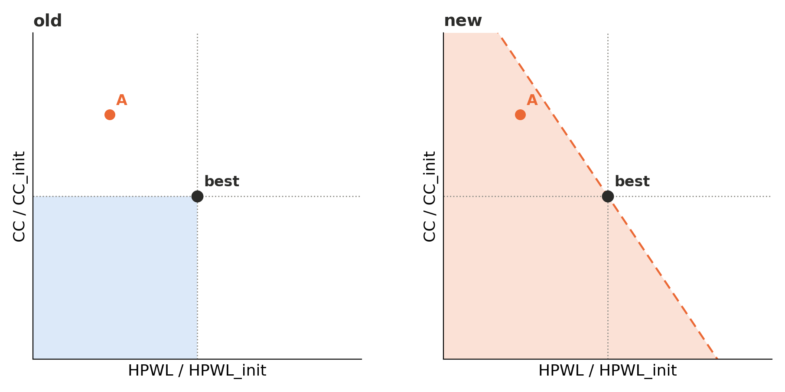

In the figure, each placement is a point at $(\text{HPWL} / \text{HPWL}_\text{init}, \text{CC} / \text{CC}_\text{init})$, and the shaded area is where a new placement replaces the best one:
- **old:** only the lower-left quadrant of the best point (both values lower). Placement A has a much shorter HPWL but a slightly higher CC, so it is dropped.
- **new:** everything below the line of constant cost through the best point. A has a lower cost, so it becomes the new best.

### 7.3 Fixed cost scale
**Problem.** The original $\Delta\text{Cost}$ was multiplied by $100 \times$ the initial temperature of the current round, and a move is accepted with probability $e^{-\Delta\text{Cost} / T}$. Since $T$ also starts from that initial temperature, lowering the initial temperature of a later round shrinks $\Delta\text{Cost}$ by the same factor: $\Delta\text{Cost} / T$, and so the acceptance probability, stays exactly the same. Every round therefore behaved like round 1: the trace showed a first acceptance rate of 89% to 93% in all five rounds.

**Change.** The scale is fixed at $S = 100 \times 800{,}000$ (Section 2). Now the initial temperature of a round really decides how hot it starts. Sections 7.2 and 7.3 were added together and are measured as one step.

**Effect.** Together with 7.2: alu4 -7.5%, apex4 -2.2%, clma_2 +0.1%, elliptic -8.1%, pdc -1.3%. The gain is largest on alu4 and elliptic; on clma_2 the change is within noise.

### 7.4 Range-limited moves
**Problem.** The original move picked a random block and a random target site **anywhere** on the chip. At low temperature, moving a block far away almost always lengthens its nets, so nearly every move was rejected: the acceptance rate at the end of each round was only about 13%, and most iterations did nothing. This is worst on large chips, where almost every random site is far away.

**Change.** The target site is picked within a square window of $\pm R_\text{limit}$ cells around the block (clipped to the chip). If the site is occupied, the two blocks are swapped. $R_\text{limit}$ adapts every temperature step, as in VPR:

$$
	R_\text{limit} \leftarrow R_\text{limit} \times (1 - 0.44 + \text{acceptRate}), \qquad 1 \le R_\text{limit} \le \max(C, R)
$$

- An acceptance rate above 44% widens the window, below 44% narrows it, so the acceptance rate is held near 44%.
- At high temperature most moves are accepted and the window stays at the whole chip (the original behavior). As the temperature drops, the window shrinks, and late moves only go to nearby sites, which are far more likely to be accepted.
- $R_\text{limit}$ is reset at the start of every round (Section 7.5).

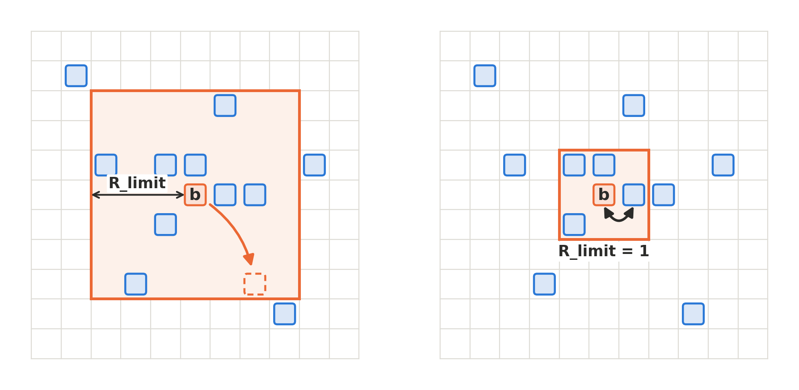

Left: a large $R_\text{limit}$ early in a round; block b may move to any site in the window. Right: $R_\text{limit} = 1$ late in a round; b may only move to its 8 neighbors, and an occupied neighbor is swapped with b.

**Effect.** This is the largest single gain on the larger cases (alu4 -2.6%, apex4 -2.6%, clma_2 -14.1%, elliptic -4.7%, pdc -7.9%). The price: each run becomes 1.5 to 3 times longer, because the acceptance rate no longer falls below 15% and the temperature keeps cooling slowly (explained in Section 7.1, Runtime; fixed in Section 7.5).

### 7.5 Colder restarts for rounds 2+ and early stop
**Problems.** With range-limited moves, the SA trace showed two kinds of wasted iterations:
1. Every round restarted from a high temperature with the whole chip as the move range. The first moves of rounds 2 to 5 scrambled the placement of the previous round, and each round mostly repeated round 1 instead of improving on it.
2. Once $R_\text{limit} = 1$, many moves do not change the cost at all and are always accepted, so the acceptance rate never falls below the 15% that triggers fast cooling. The temperature kept dropping slowly from about $10^4$ to $10^{-3}$, while the cost stopped improving long before.

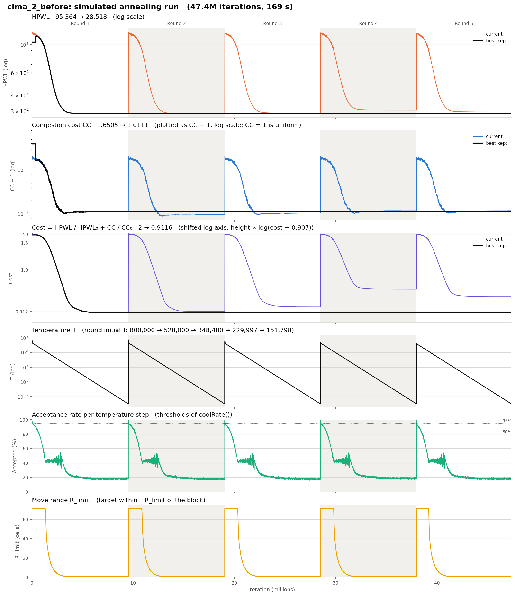

The SA run of clma_2 (seed 1) with range-limited moves, before this change, shows problem 1. Rounds 2 to 5 restart at 528,000, 348,480, 229,997 and 151,798 with the whole chip as the move range ($R_\text{limit}$ panel), so HPWL jumps back to about 125,000, above the initial 95,364. Each round then cools down again but ends 0.05%, 0.27%, 2.2% and 1.1% **above** the best placement of round 1: in the cost panel, the best-kept cost stays at 0.9116 after round 1, while rounds 2 to 5 end at 0.912, 0.914, 0.932, 0.921, never below it. The output is the placement found in round 1, and rounds 2 to 5 only add runtime (169 seconds in total). The long flat tails of every round, with an acceptance rate just above 15%, show problem 2.

**Change 1: colder restarts.** During round 1, the temperature at which $R_\text{limit}$ first shrinks to half of the chip is recorded as $T_\text{reheat}$. This is where the moves turn from global to local. Rounds 2+ restart from there instead of from $T_0$:

| Round | Initial $T$ | Initial $R_\text{limit}$ |
|-------|-------------|---------------------------|
| 1 | $T_0 = 800{,}000$ | whole chip, $\max(C, R)$ |
| $k \ge 2$ | $T_\text{reheat} \times 0.66^{k-2}$ | $0.5 \times \max(C, R)$ |

The later rounds are hot enough to move blocks out of round 1's local minimum, but not hot enough to scramble the whole placement. Starting points at 10%, 25% and 50% of the chip were compared (with the earlier $\text{HPWL} \cdot \text{CC}$ cost); 50% gave the lowest cost, mainly on clma_2 ($-3.1\%$, $-5.6\%$, $-8.6\%$ against range-limited moves alone), so the smaller values seem to start too cold for the later rounds to leave round 1's result.

**Change 2: early stop.** After every temperature step:
```
cost = Cost of the current placement
if R_limit <= 1 for the first time in this round:
    roundBest = cost                    // the local phase starts here
    stallSteps = 0
else if cost < roundBest * (1 - 0.0001):   // improved by more than 0.01%
    roundBest = cost
    stallSteps = 0
else if R_limit <= 1:
    stallSteps += 1
if stallSteps >= 20:                    // 20 steps = 100,000 iterations
    end this round
```
- `roundBest` is set when $R_\text{limit}$ first reaches 1 in the round, and counting only starts from there. A restarted round first gets worse and then improves again; its earlier costs, including those right after the restart, are lower than anything the local phase can reach at first, and using them as the reference would end the round before it has recovered.
- The high-temperature part of a round, where the cost moves up and down, is therefore never cut short.

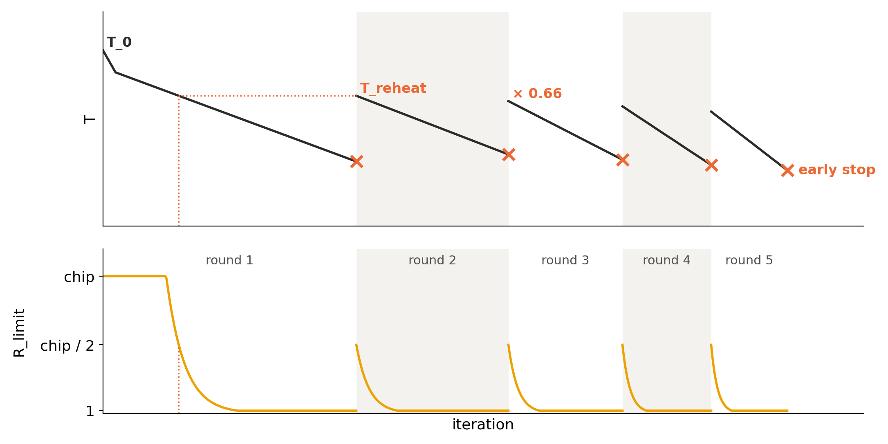

The figure sketches one run: round 1 starts at $T_0$ with the whole chip as the move range; $T_\text{reheat}$ is taken where its move range reaches half the chip (dotted lines); rounds 2 to 5 start at $T_\text{reheat}$, then $0.66\times$ lower each round, with half the chip as the move range; and every round ends early once it stops improving (×).

**Effect.** Runtime drops 3.3 to 5.0 times compared with range-limited moves alone, to below that of w/o Round2+ Enhancement, at the same or a lower cost (alu4 0.0%, apex4 -0.1%, clma_2 -3.1%, elliptic -0.1%, pdc -0.1%). The later rounds now improve on round 1: on clma_2, the cost at the end of round 1 is 4.4% above the final result, and rounds 2 to 5 each close part of that gap:

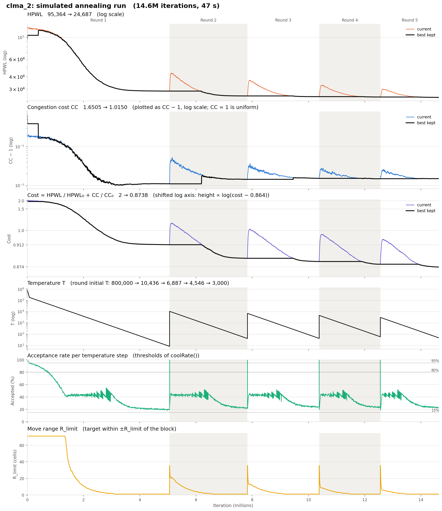

Compared with the run before: the restarts only raise HPWL to about 43,000 instead of 125,000, every round lowers the best-kept cost further (cost panel: 0.912 → 0.882 → 0.879 → 0.876 → 0.874 at the end of rounds 1 to 5), and the rounds end once they stop improving, so the whole run takes 47 seconds instead of 169.

### 7.6 Guided moves
**Idea.** A random move rarely helps once the placement is good. A guided move instead picks a block that is likely to shorten its nets when moved, moves it to where its nets are shortest, and prefers a site with little congestion so that CC does not rise. Guided moves are used for 30% of the moves in rounds 2+; round 1 still explores with random moves only.

**Optimal region of a block.** For a block $b$, take each of its nets and compute the bounding box of the net **without** $b$; along the x axis this gives a span $[l_n, h_n]$ per net. With $b$ at column $p$ (occupying $[p, p+1]$), the total x-span of its nets is

$$
	f(p) = \sum_n \max(h_n, p + 1) - \min(l_n, p)
$$

$f$ is convex and piecewise linear: each net adds a slope of $-1$ while $p < l_n$ (b is left of the net's other terminals, so moving b right shrinks the net) and $+1$ while $p > h_n - 1$ (b is right of them). Inside $[l_n, h_n - 1]$ b is not on the net's edge, and moving it does not change that net. The total slope changes from negative to positive at the median, so $f$ is minimal for $p$ between the two middle values of $\{l_n\} \cup \{h_n - 1\}$. The same is done for the y axis, and the two intervals form the **optimal region**.

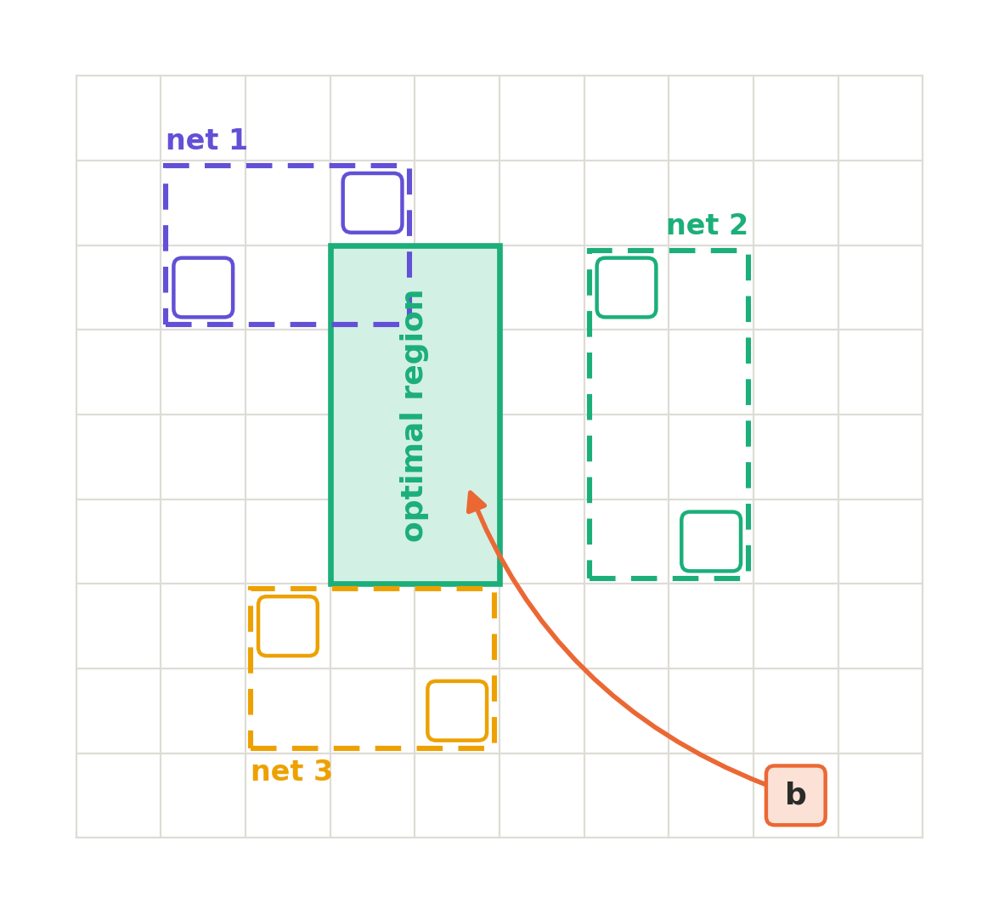

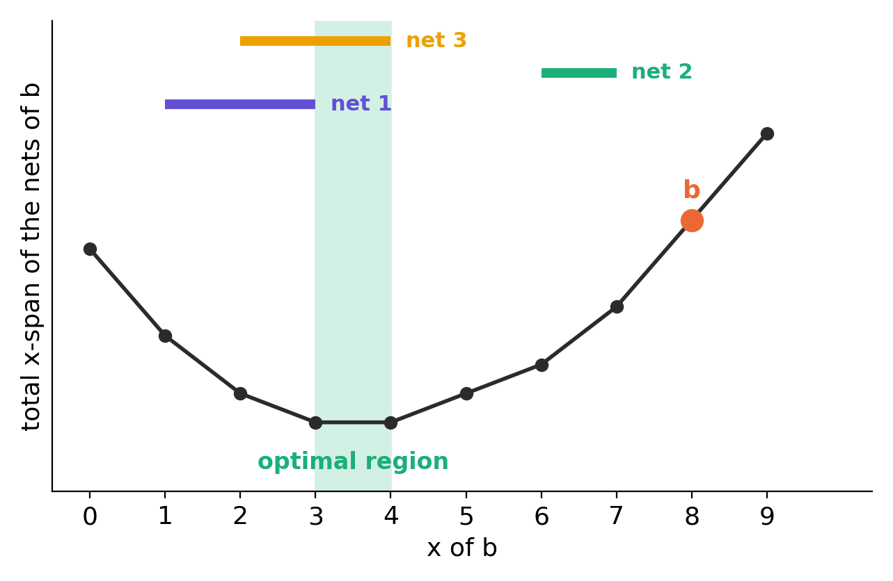

In the example, b belongs to three nets; the dashed boxes are the nets without b. Along x, the intervals $[l_n, h_n - 1]$ are net 1: $[1, 3]$, net 2: $[6, 7]$ and net 3: $[2, 4]$, so the six values are $1, 2, 3, 4, 6, 7$ and the two middle ones give columns 3 to 4, where $f$ is lowest. Along y the same gives rows 3 to 6. b is currently at column 8, where $f$ is much higher.

This formalizes the idea of a block being the **anchor** on the same side of several nets: a net only pulls b towards it when b is alone on one edge of its bounding box, and only as far as the next terminal. The median weighs all nets of b at once and also tells how far to move.

**Choosing the block.** 4 random blocks are evaluated, and the one with the largest gain $f(\text{current position}) - f(\text{optimal region})$, summed over x and y, is moved (a tournament). Blocks already inside their optimal region have no gain and are skipped; if none of the 4 can gain, a normal range-limited move is made instead.

**Choosing the target.** 4 random sites in the optimal region are sampled. An empty site is preferred over an occupied one (a swap also moves the other block away), and among those, the site with the lowest coverage $U$ is taken, so the nets of b are moved into the least congested part of the region.

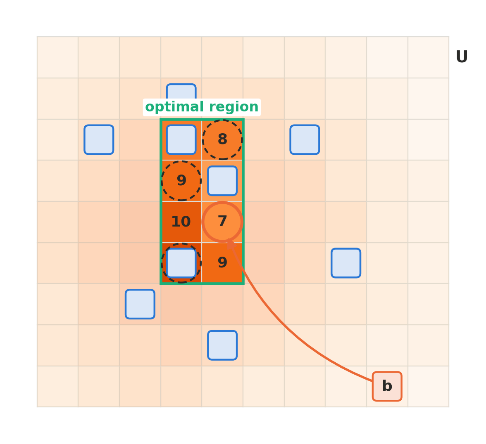

In the figure, the four dashed circles are the sampled sites, and the numbers are $U$ of the empty sites in the optimal region. The occupied sample is skipped, and the empty site with $U = 7$ is chosen.

**Details.**
- Nets with more than 30 terminals are skipped: they span most of the chip, are expensive to scan, and hardly depend on one block.
- The guided move is then evaluated like any other move: $\Delta\text{Cost}$ decides whether it is accepted, so a guided move that raises CC too much can still be rejected.
- 30% and 60% guided moves were compared (before the early-stop fix of Section 7.5); 60% gave a higher cost than 30% in 4 of 5 cases. A likely reason is that with more guided moves, fewer random moves are left to explore, and the tournament keeps picking the same few blocks with the largest gain.

**Effect.** The cost drops in 4 of 5 cases and is unchanged on apex4 (alu4 -0.1%, apex4 0.0%, clma_2 -0.9%, elliptic -0.3%, pdc -0.2%); only clma_2 and elliptic are clearly beyond the seed-to-seed noise. Runtime grows by up to 15%. Guided moves mostly shorten HPWL (mean HPWL: alu4 -1.4%, apex4 -0.7%, clma_2 -3.9%, elliptic -1.7%, pdc -1.6%), while CC rises slightly (mean CC: alu4 +0.0072, apex4 +0.0048, clma_2 +0.0034, elliptic +0.0040, pdc +0.0066), since the optimal region is chosen by wirelength and $U$ only breaks ties within it.

### 7.7 Results on the hidden test cases
The three hidden test cases were only added after every parameter of Sections 7.2 to 7.6 had been chosen on the five public ones, so they show how well the changes carry over to unseen and much larger designs (2,187 to 3,577 nets and 3,288 to 13,000 blocks, against at most 1,559 nets and 3,580 blocks in the public cases; see Section 1). They were measured exactly like Section 7.1: every earlier version rebuilt with the cost of Section 2, seeds 1 to 5, 15 runs in parallel. The seed-to-seed standard deviation of the current version's cost is 0.1% to 0.2%. The tables of Section 7.1 already include them; the table below repeats the per-step change for the discussion here.

**Change of each step** (change of the mean cost from the step before; negative is better):

| Step | Section | hidden1 | hidden2 | hidden3 | Mean |
|------|---------|---|---|---|---|
| w/o Round2+ Enhancement (cost) | | 0.8924 | 0.9385 | 1.2389 | 1.0233 |
| Best by total cost, fixed cost scale | 7.2, 7.3 | -0.2% | -0.3% | -0.5% | -0.3% |
| Range-limited moves | 7.4 | -16.3% | -19.5% | -22.1% | -19.3% |
| Colder restarts, early stop | 7.5 | -1.9% | -4.4% | -6.5% | -4.3% |
| Guided moves | 7.6 | -1.3% | -2.5% | -3.1% | -2.3% |
| **Total vs w/o Round2+ Enhancement** | | **-19.1%** | **-25.2%** | **-29.8%** | **-24.7%** |

The change of each stage from w/o Round2+ Enhancement in cost, HPWL and CC, and the runtime of each stage, are in the tables of Section 7.1, which cover all eight test cases.

**Observations.**
- The current version lowers the cost by 19% to 30% against w/o Round2+ Enhancement, more than on any public test case (4.9% to 17.5%). The larger the design, the more the changes help, as already seen on clma_2, the largest public case.
- **Range-limited moves** again give the largest single gain (hidden1 -16.3%, hidden2 -19.5%, hidden3 -22.1%), because on a large chip almost every random far move is rejected. They also make the two larger runs longer (hidden2 +19%, hidden3 +27% against w/o Round2+ Enhancement): up to 219 seconds of CPU time on hidden3, close to the 235-second limit.
- **Colder restarts and early stop** matter much more here than on the public cases (hidden1 -1.9%, hidden2 -4.4%, hidden3 -6.5%), besides cutting the runtime by more than half: the later rounds keep improving on the large designs (see the SA plot below).
- **Guided moves** also help clearly more than on the public cases (hidden1 -1.3%, hidden2 -2.5%, hidden3 -3.1%), all far beyond the seed-to-seed noise. On a large chip, a random move within $R_\text{limit}$ rarely lands where a block's nets are shortest, so moving it straight into its optimal region pays off more.
- As on the public cases, almost all of the gain comes from HPWL: CC is already within about one point of its bound for w/o Round2+ Enhancement.
- The current version's longest run takes 89 seconds of CPU time, well within the 235-second limit.

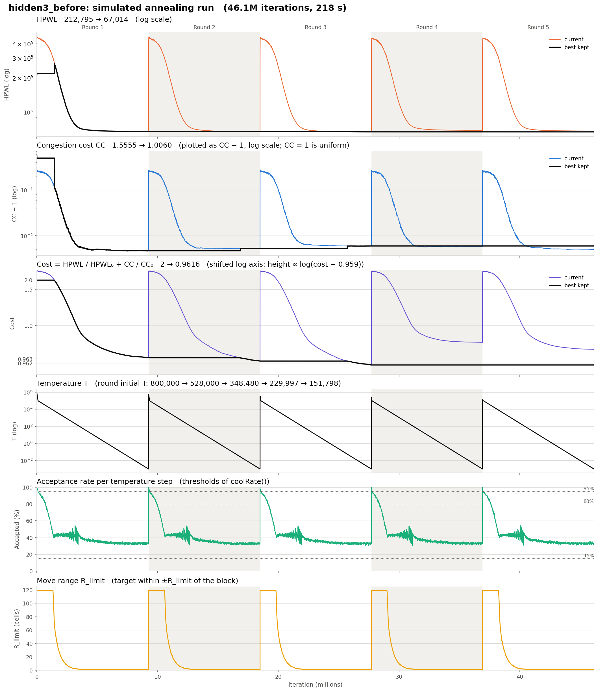

Before colder restarts (range-limited moves only, seed 1), the restarted rounds on hidden3 even climbed to about 450,000 HPWL, more than twice the initial 212,795, and rounds 2 to 5 together improved on round 1 by only 0.17%.

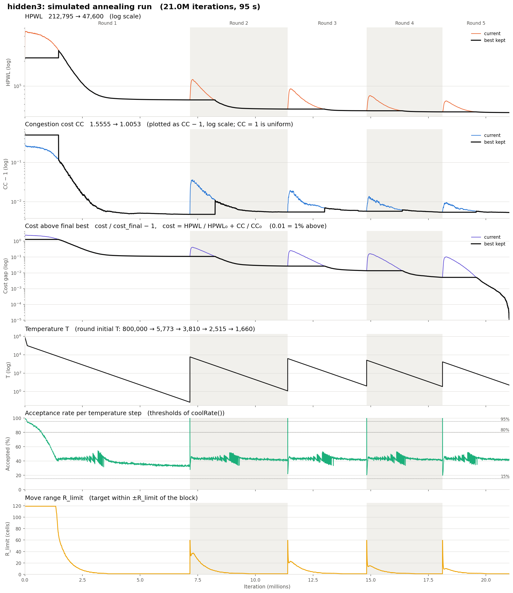

With the current version (seed 1), the end of round 1 is 10.8% above the final result, and every round from 2 to 5 lowers the best cost further (cost panel). Even with $R_\text{limit} = 1$, the acceptance rate stays around 33% to 42% on this large chip, so the rounds end through the early stop rather than by cooling to $T < 10^{-3}$.

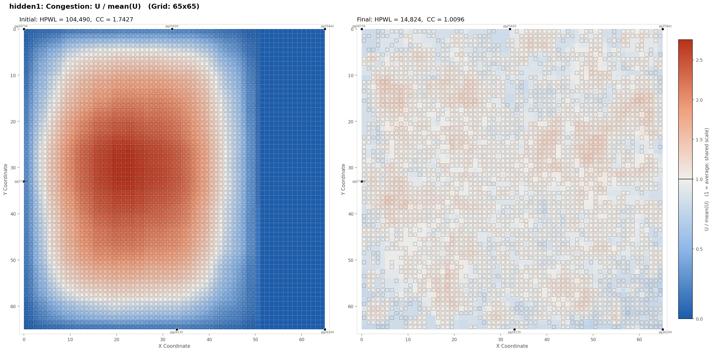

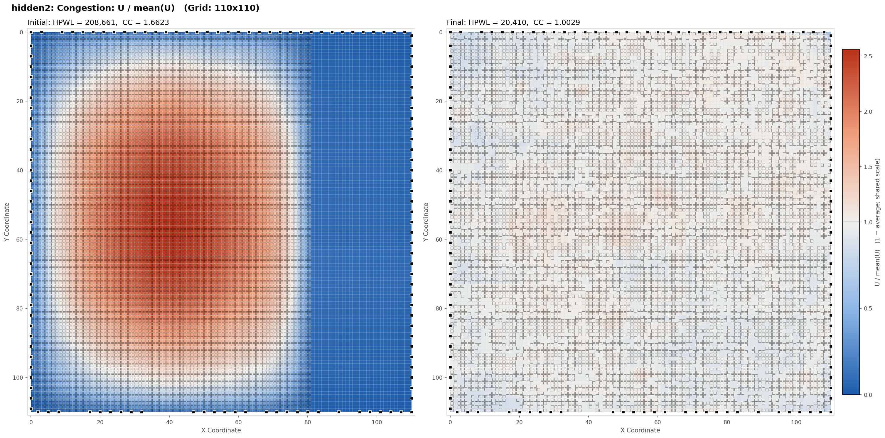

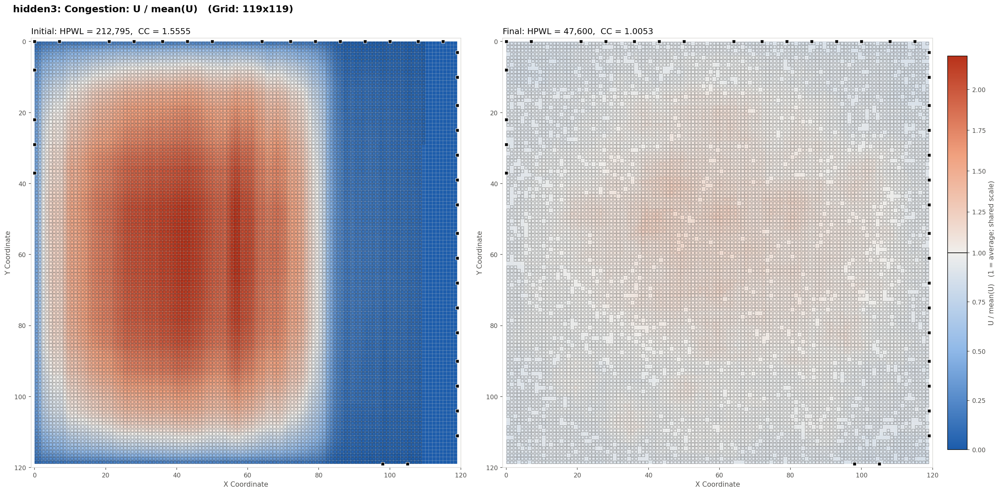

The congestion maps ($U / \text{mean}(U)$ on one shared scale, seed 1) show the initial placement on the left, which fills the chip column by column and leaves the right side empty, and the final placement on the right, where the coverage is nearly uniform.

### 7.8 Tools added for the analysis
- The SA trace, the seed option and `bench.py` (Section 6) were added to see where the original placer wasted time and to measure every step with several seeds.
- The plots in `plot/` and the diagrams in `docs/figures/` (Section 6) visualize the results and the algorithm.

## References
<!-- To be completed manually -->
1. “A Congestion Driven Placement Algorithm for FPGA Synthesis”, In Proceedings of the International Conference on Field Programmable Logic and Applications (FPL 2006)
2. Vaughn Betz and Jonathan Rose. 1997. VPR: A new packing, placement and routing tool for FPGA research. In Proceedings of the 7th International Workshop on Field-Programmable Logic and Applications (FPL '97). Springer-Verlag, Berlin, Heidelberg, 213–222.